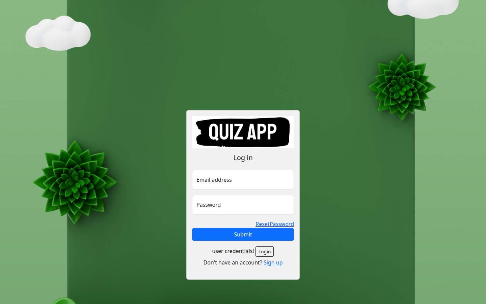

# 🧠 MERN Quiz App

A full-stack quiz game where users sign up, pick a category, answer timed questions and track their scores.

**▶ Live demo: [saravanan-22.github.io/mern-quiz-app](https://saravanan-22.github.io/mern-quiz-app/)**
Try it instantly with the **demo account**: `demo@quizapp.dev` / `demo1234` (or click "Login" under *user credentials*).

> The API runs on Render's free plan, which sleeps when idle. The first request after a quiet period can take up to a minute while it wakes up.

<p>
  
  
</p>

## Features
- 🔐 Sign up, log in, reset password, edit profile (with profile picture) and delete account
- 🗂️ 10 categories: General Knowledge, Sports, Computers, History, Politics, Art, Science & Nature, Animals, Vehicles, Comics
- ⏱️ Timed questions with shuffled answers
- 🏆 Points system: current, previous and total scores saved per user
- 🌐 REST API built with Express + MongoDB

## Security
- Passwords are **hashed with bcrypt** and checked on the server (`POST /api/v1/users/login`), never in the browser
- API responses never include password hashes, and there is no endpoint that lists users
- Password reset requires the account's email **and** registered phone number
- Question-creation endpoints are admin-only (`x-admin-key` header)

## Tech stack
**Frontend:** React · React Router · Material UI · React Bootstrap · Axios
**Backend:** Node.js · Express · MongoDB · Mongoose · bcrypt
**Deploy:** GitHub Pages (client, via GitHub Actions) · Render (API) · MongoDB Atlas (database)

## Architecture
```
GitHub Pages (React)  ──HTTPS/JSON──▶  Render (Express API)  ──▶  MongoDB Atlas
```

## Project structure
```
client/          React frontend (API address set with REACT_APP_API_URL)
server/          Express REST API (routes, controllers, Mongoose models)
server/seed/     Bundled questions + demo user, loaded automatically into an empty database
render.yaml      Render Blueprint for the API
.github/workflows/deploy-client.yml   Builds the client and publishes it to GitHub Pages
```

## API overview
| Method | Endpoint | Purpose |
|---|---|---|
| POST | `/api/v1/users/create` | Sign up |
| POST | `/api/v1/users/login` | Log in |
| GET | `/api/v1/users/getCurrentPoints/:id` | Get a user's profile and points |
| PUT | `/api/v1/users/editedUserData/singleUser/:id` | Edit profile |
| POST / PATCH | `/api/v1/users/forgotPassword[/verify]` | Reset password (email + phone) |
| DELETE | `/api/v1/users/deleteAccount/:id` | Delete account |
| GET | `/api/v1/questions/:category` | Questions for a category |
| GET | `/api/health` | Health check |

## Run locally
```bash
git clone https://github.com/saravanan-22/mern-quiz-app.git
cd mern-quiz-app

# backend
cd server && npm install
cp .env.example .env   # then add your MongoDB connection string
npm run dev            # questions and the demo user are added on first start

# frontend (new terminal)
cd client && npm install
REACT_APP_API_URL=http://localhost:5000 npm start
```

## Credits
Quiz questions are from the [Open Trivia Database](https://opentdb.com/), licensed under [CC BY-SA 4.0](https://creativecommons.org/licenses/by-sa/4.0/).

## License
[MIT](LICENSE) © Saravanan
